# ha-solar-roof-card

[](https://www.home-assistant.io/integrations/marketplace/)
[](https://github.com/juju35/ha-solar-roof-card/actions/workflows/hacs.yml)
[](https://github.com/juju35/ha-solar-roof-card/actions/workflows/validate.yml)
[](https://github.com/juju35/ha-solar-roof-card/actions/workflows/lint.yml)
[](https://github.com/juju35/ha-solar-roof-card/releases/latest)
[](https://github.com/juju35/ha-solar-roof-card/blob/main/LICENSE)
[](https://buymeacoffee.com/julienstep9)

<p align="center"></p>

<p align="center">
  &nbsp;&nbsp;
  &nbsp;&nbsp;
  &nbsp;&nbsp;
  &nbsp;&nbsp;
  &nbsp;&nbsp;
  
</p>

A Lovelace card for **your solar panels, panel by panel**: each micro-inverter, optimiser or string is a cell coloured by its production, grouped by string, so a shaded or failing panel stands out at a glance — with what is wrong and since when.

[](https://my.home-assistant.io/redirect/marketplace_repository/?owner=juju35&repository=ha-solar-roof-card&category=plugin)

| Card | Type | What it shows |
|---|---|---|
| [Solar roof](#screenshots) | `custom:solar-roof-card` | Each panel as a cell coloured by its production, grouped by string, the panels to check flagged with since when. |
| [Solar roof mini](#solar-roof-mini) | `custom:solar-roof-mini-card` | The power now and one small cell per panel on two lines, with a zoom to the full card. |

| Two panels to check | Every panel fine |
|---|---|
| 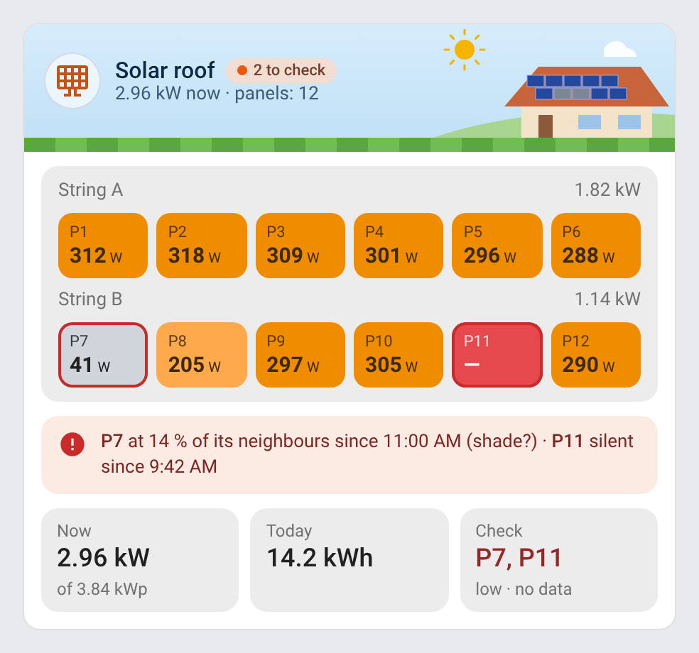 | 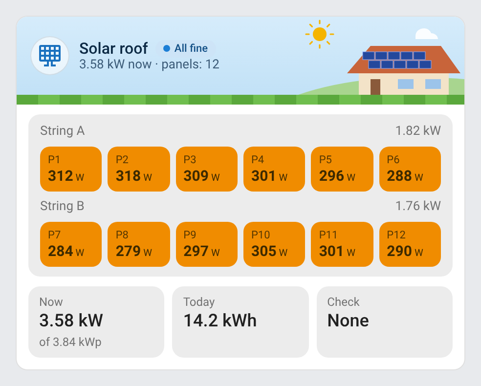 |

## Features

- **A heat grid per string**: one cell per panel with its label and power, coloured by its share of the strongest panel (deeper orange: more), each string with its total
- **The panels to check**: a panel making less than `threshold` % (50 by default) of the median of its string is **low** (pale red, ringed in red), one that reports nothing is **silent** (red); an alert says which, at what share of its neighbours and since when (*P7 at 14% of its neighbours since 1:00 PM (shade?) · P11 silent since 11:42 AM*)
- **Three tiles**: the power now (with the peak power, `peak_power`), today's energy (`energy`, else the number of panels) and the panels to check
- **Any number of panels**: the cells wrap; no layout to draw
- **By night** nothing is flagged: micro-inverters that go to sleep are not silent panels; nor at sunrise and sunset, while the sun is under 10°
- **Illustrated header**: a house whose roof carries ten panels, the panels to check in red, in proportion; while the panels produce, the sun's rays turn and a glint sweeps over them; the moon by night, the dark theme darkens the picture
- **Mini card**: the share of panels in line as a ring around the badge, the state, the power now and one small cell per panel; its zoom button opens the full card in place
- **Tap a cell** (or a tile) to open its sensor's history
- Visual editor for both cards, light and dark themes, 22 languages, no external dependency

## Supported integrations

The card finds the power sensor of each micro-inverter, optimiser or string these integrations expose, and groups them by device (a DTU's inverter, a string). Any other power sensors can be listed under `panels`:

| | Integration | What the cards show |
|:---:|---|---|
|  | [Enphase Envoy](https://www.home-assistant.io/integrations/enphase_envoy/) (built in) | Power of each IQ micro-inverter |
|  | [OpenDTU / AhoyDTU](https://github.com/tbnobody/OpenDTU) (MQTT) | Hoymiles micro-inverters through MQTT discovery, power of each inverter and input |
|  | [Hoymiles](https://github.com/suaveolent/ha-hoymiles-wifi) (Marketplace) | Hoymiles HMS micro-inverters through their DTU, power of each input |
|  | [APsystems ECU Reader](https://github.com/HAEdwin/homeassistant-apsystems_ecu_reader) (Marketplace) | Power of each inverter channel |
|  | [Huawei Solar](https://github.com/wlcrs/huawei_solar) (Marketplace) | Huawei SUN2000 optimisers |
|  | [SolarEdge Optimizers](https://github.com/ProudElm/solaredgeoptimizers) (Marketplace) | Power of each SolarEdge optimiser |
|  | [Fox ESS Modbus](https://github.com/nathanmarlor/foxess_modbus) (Marketplace) | Power of each PV string |

## Installation

### Via the Marketplace (recommended)

Click the button below to add the repository directly:

[](https://my.home-assistant.io/redirect/marketplace_repository/?owner=juju35&repository=ha-solar-roof-card&category=plugin)

Or manually:

1. Open **Settings → Marketplace → Add from link** (top right; this needs a GitHub account connected)
2. Add `https://github.com/juju35/ha-solar-roof-card` — Type: **Dashboard**
3. Open **Solar Roof Card** and click **Install**
4. Clear your browser cache and refresh

The Marketplace registers the dashboard resource for you.

### Manual

1. Download `ha-solar-roof-card.js` and the `ha-solar-roof-card.i18n.*.js` translation files from the [latest release](https://github.com/juju35/ha-solar-roof-card/releases/latest)
2. Copy them all to `/config/www/` (without the translation files, the cards show in English)
3. Go to **Settings → Dashboards → Resources** → Add resource:
   - URL: `/local/ha-solar-roof-card.js`
   - Type: **JavaScript Module**
4. Clear your browser cache and refresh

## Configuration

Every option is in the visual editor (`panels` in YAML). In YAML:

```yaml
type: custom:solar-roof-card

# With the installation's peak power and today's energy
type: custom:solar-roof-card
peak_power: 3840
energy: sensor.solar_energy_today

# Your own panels, named and grouped by string
type: custom:solar-roof-card
panels:
  - entity: sensor.hm_800_ch1_power
    name: East 1
    string: East roof
  - entity: sensor.hm_800_ch2_power
    name: East 2
    string: East roof
  - entity: sensor.hm_600_ch1_power
    name: Garage
    string: Garage

# Two lines on a phone dashboard
type: custom:solar-roof-mini-card
```

| Option | Type | Default | Description |
|---|---|---|---|
| `panels` | list | found automatically | Advanced (YAML only): the panels' power sensors, each an entity id or `{ entity, name, string }`; the cells follow its order |
| `title` | string | `Solar roof` | Card title |
| `show_title` | boolean | `true` | Both: show the title |
| `show_subtitle` | boolean | `true` | Both: the power now and the number of panels under the title |
| `navigation_path` | string | | Both: a tap on the header opens this dashboard path |
| `peak_power` | number | | The installation's peak power (Wp), shown under the power now |
| `energy` | string | | A daily energy sensor of the installation (kWh), in the second tile (else the number of panels) |
| `threshold` | number | `50` | A panel below this share (%) of its string's median is low |
| `show_alerts` | boolean | `true` | The alert under the grid (and the night note) |
| `show_tiles` | boolean | `true` | The three tiles |
| `illustration` | boolean | `true` | Both: the illustrated header (`false`: the classic header) |
| `illustration_theme` | string | `auto` | Both: `auto` (follows the Home Assistant theme: night with a dark theme, day with a light theme), `day` or `night` |
| `animations` | boolean | `true` | Both: the sun's rays and the glint over the panels |
| `zoom` | boolean | `true` | Mini card: the zoom button |
| `language` | string | Home Assistant's | Advanced: one of the [languages](#translations) |

## Screenshots

| Two panels to check | Every panel fine | Night |
|---|---|---|
|  |  | 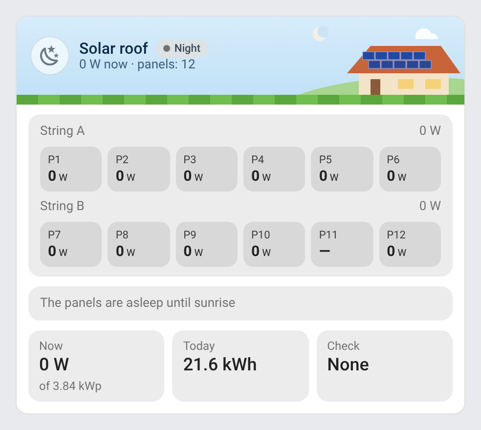 |
| 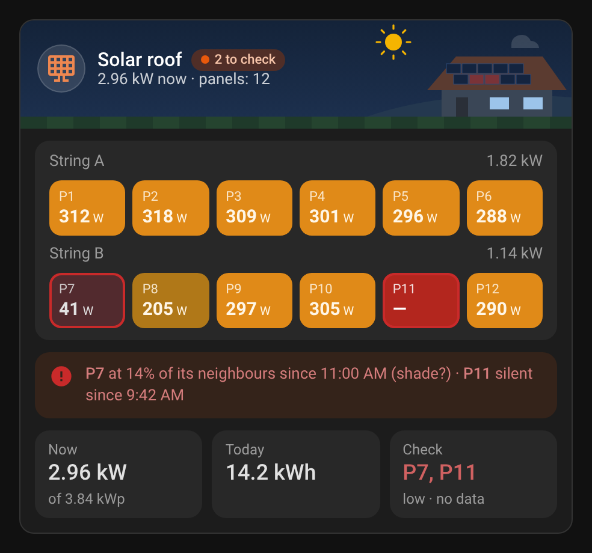 | 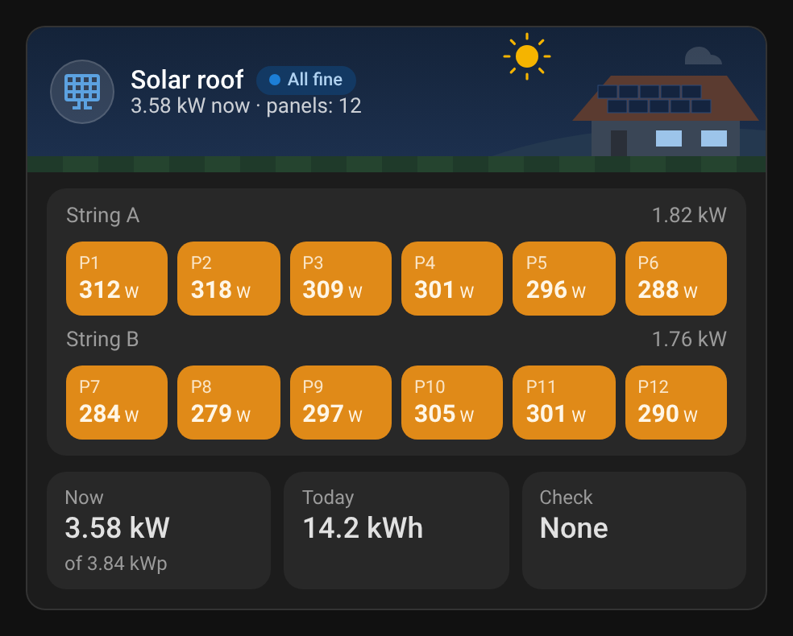 | 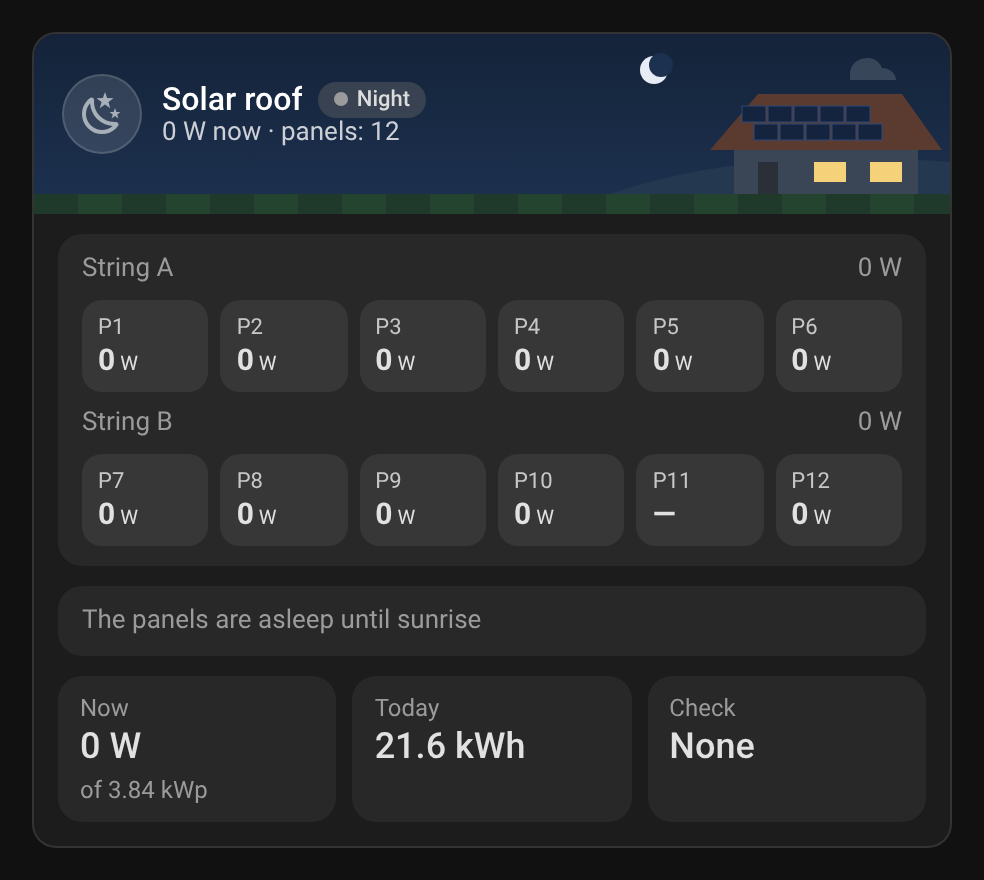 |

| 24 micro-inverters on three roofs | Narrow |
|---|---|
| 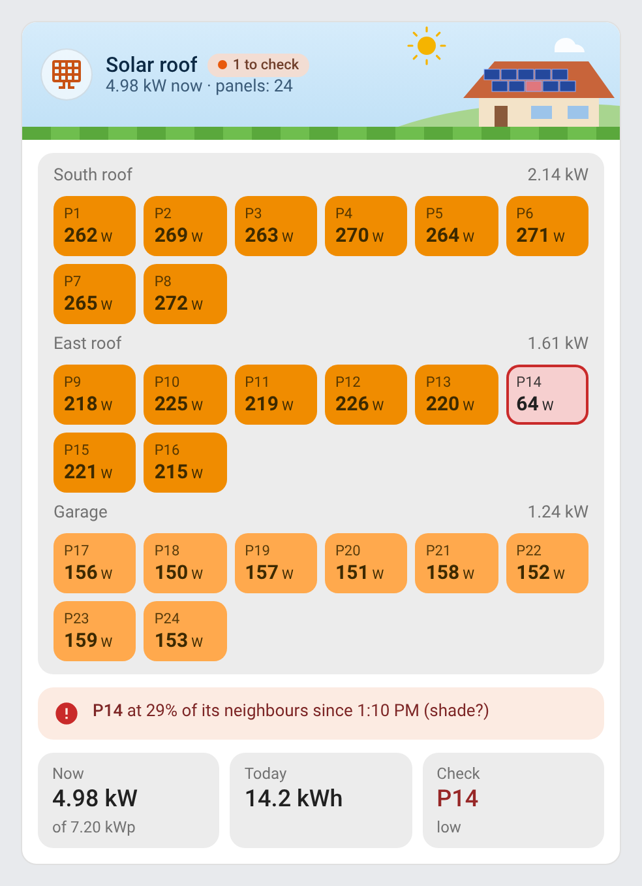 | 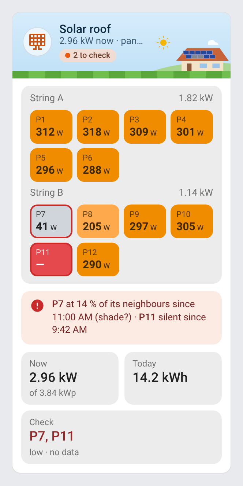 |
| 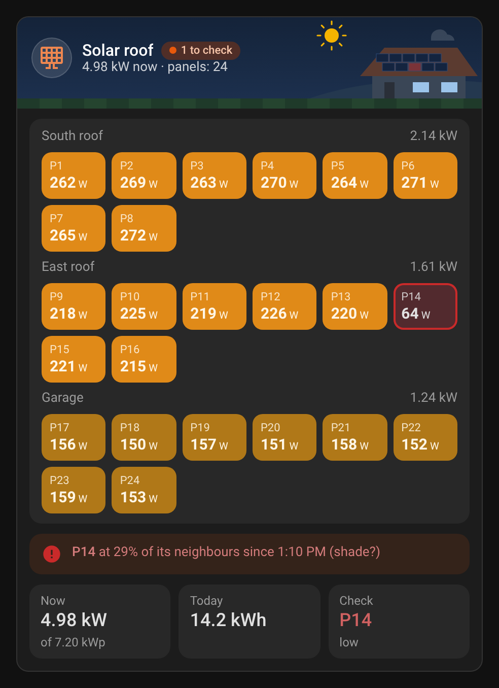 | 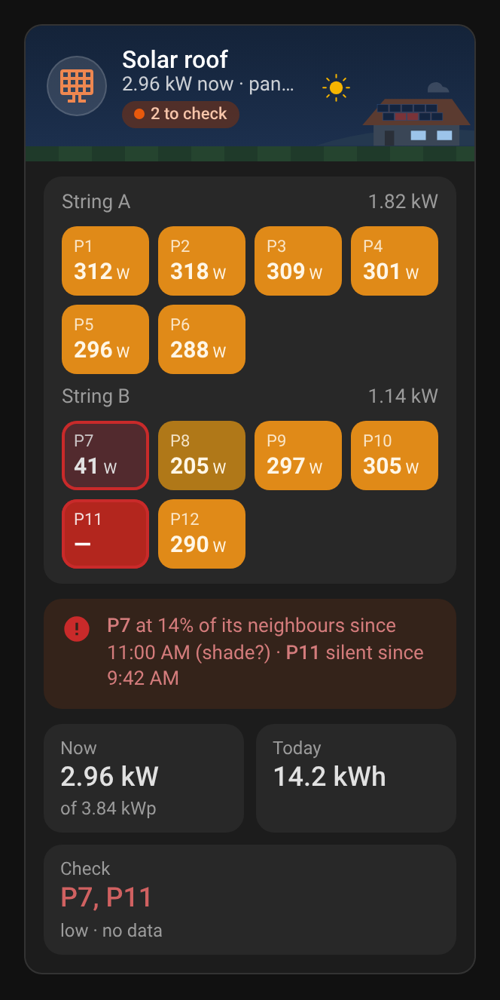 |

**Producing animation**: the sun's rays turn and a glint sweeps over the roof's panels while they produce (still with `animations: false`, or when the system asks for reduced motion).

| Light | Dark |
|---|---|
| 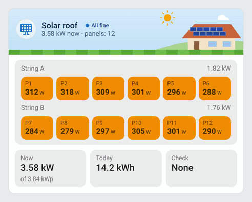 |  |

### Solar roof mini

| Two panels to check | Every panel fine | Zoomed in |
|---|---|---|
| 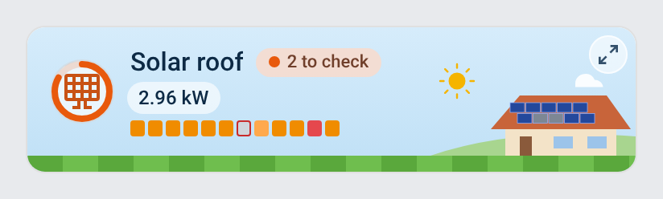 | 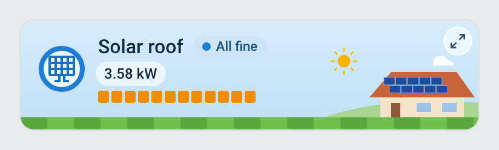 | 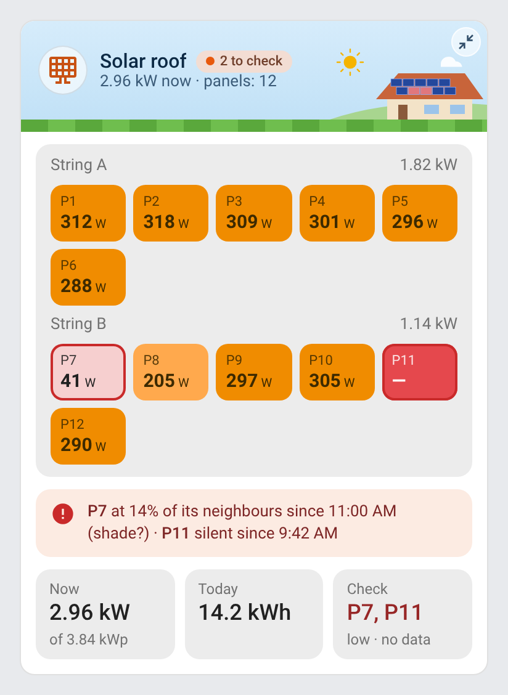 |
| 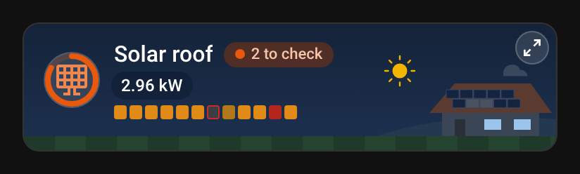 | 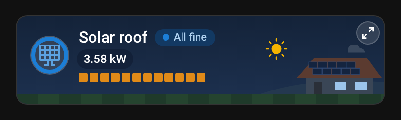 | 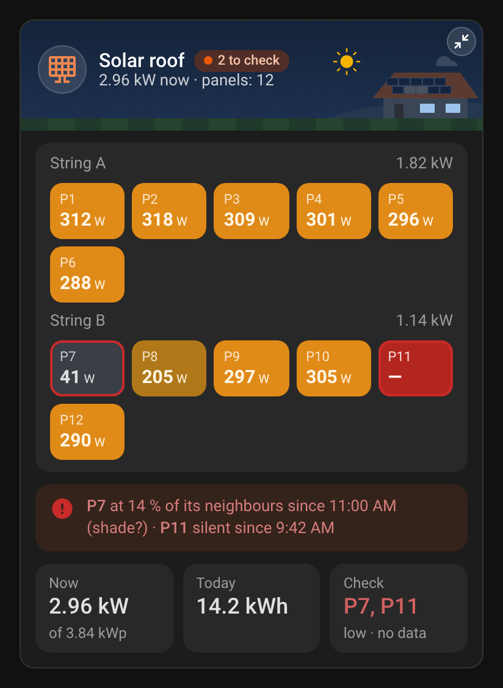 |

| Producing animation | Dark |
|---|---|
| 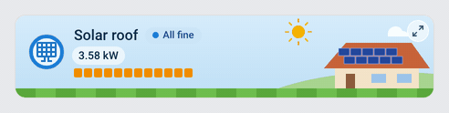 | 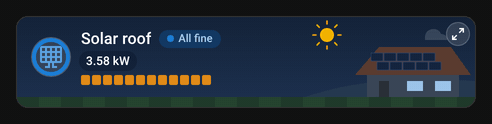 |

## How it works

- **Panels**: `panels`, else the power sensors of a panel integration, by their entity id or translation key: Enphase Envoy's micro-inverters (`sensor.inverter_<serial>`), OpenDTU / AhoyDTU's DC inputs over MQTT (`…_ch1_power`, `…_ch1_p_dc` on a Hoymiles or TSUN device, by its manufacturer or model; not the inverter's `ch0` total), Hoymiles' ports, APsystems' channels, Huawei Solar's optimisers, SolarEdge Optimizers, Fox ESS's PV strings; totals, grid, load and battery sensors are left out. They are labelled P1, P2… in their entity ids' natural order (their names in the tooltips) and grouped by device
- **Low**: under `threshold` % of its string's median (of every panel's when its string has fewer than three), once that median is over 30 W; **silent**: unavailable or unknown; *since*: the sensor's last change
- **Night**: while `sun.sun` is below the horizon (without it, when no panel makes 5 W): nothing is flagged; nor while its `elevation` is under 10°
- **Refresh**: live, at each state change of the panels' sensors; nothing is fetched
- **Read only**: the card calls no action

## Development

```bash
npm install
npm run build        # stamps the version of package.json into dist/ha-solar-roof-card.js
npm run check        # builds and checks the bundle (run in CI)
npm test             # unit tests
npm run screenshots  # renders the cards with mock panels into screenshots/ (and the GIFs, needs ffmpeg)
```

`dist/` is not committed: `npm run build` creates it locally, CI builds it on every push, and the release workflow attaches the built files to the release, which is where the Marketplace installs them from.

### Releasing

1. Bump `version` in `package.json`
2. Add a `## <version>` section at the top of [CHANGELOG.md](https://github.com/juju35/ha-solar-roof-card/blob/main/CHANGELOG.md)
3. Push to `main`: the **Release** workflow builds the card, creates the tag and the GitHub release with the changelog section as notes, and attaches `ha-solar-roof-card.js` and its translation files

## Translations

The card auto-detects the language from your Home Assistant settings. Currently supported:

| Language | Code |
|---|---|
| English | `en` |
| Français | `fr` |
| Deutsch | `de` |
| Español | `es` |
| Српски | `sr` |
| Srpski (latinica) | `sr-Latn` |
| Italiano | `it` |
| Nederlands | `nl` |
| Português (Portugal) | `pt` |
| Polski | `pl` |
| Română | `ro` |
| Dansk | `da` |
| Svenska | `sv` |
| Български | `bg` |
| Русский | `ru` |
| Українська | `uk` |
| Magyar | `hu` |
| Slovenčina | `sk` |
| Čeština | `cs` |
| Slovenščina | `sl` |
| Latviešu | `lv` |
| Ελληνικά | `el` |

Contributions for additional languages are welcome!

## License

[MIT](https://github.com/juju35/ha-solar-roof-card/blob/main/LICENSE)

## Support

If you find this project useful, you can support its development:

<a href="https://buymeacoffee.com/julienstep9"></a>
